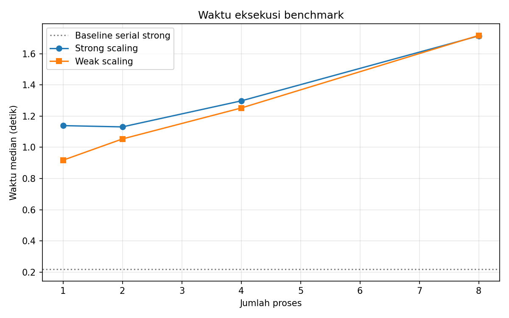
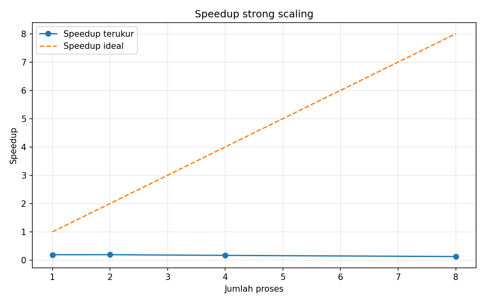
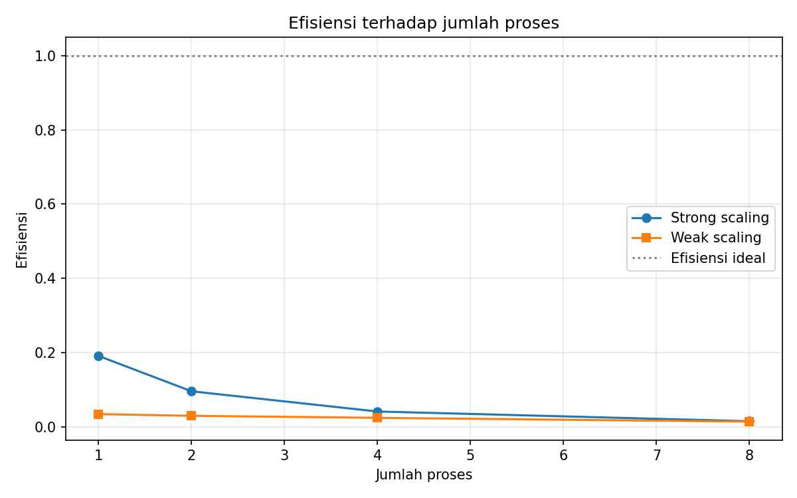

# Benchmark Skalabilitas Komputasi Paralel

Studi kasus ini mengukur speedup dan efisiensi simulasi Monte Carlo untuk mengestimasi nilai pi. Kode dapat dijalankan pada komputer multi-core biasa dan tidak membutuhkan akses superkomputer.

## Latar belakang

Materi kuliah praktisi **“Bridging Global Infrastructure to Address Local Challenge with HPC”** oleh Asst. Prof. Dr. Worawan Diaz Carballo (Thammasat University) menekankan penggunaan HPC untuk tantangan lokal melalui integrator yang menyusun workflow dari data hingga hasil. Materi juga menyebut keterampilan Linux, batch script, MPI, dan performance tuning, serta pentingnya dokumentasi agar artefak dapat diulang.

Proyek ini menerapkan gagasan workflow dan dokumentasi pada eksperimen komputasi paralel sederhana. Python `multiprocessing` membagi skenario independen ke beberapa proses. Pemilihan Monte Carlo adalah **usulan implementasi** untuk pembelajaran, bukan klaim bahwa contoh ini disebutkan dalam materi.

## Deskripsi artefak dan beban kerja

Setiap titik acak ditempatkan di persegi `[-1, 1] x [-1, 1]`. Rasio titik di dalam lingkaran satuan digunakan untuk mengestimasi pi. Banyak skenario berseed tersendiri dapat dikerjakan independen, sehingga beban mudah dibagi dan digabung tanpa komunikasi antarskenario. Perulangan Python membuatnya relatif CPU-bound dan memungkinkan overhead proses terlihat.

Seed dihitung tetap dari seed dasar dan ID skenario, bukan urutan penjadwalan proses. Dengan demikian, setiap skenario memperoleh aliran bilangan acak yang sama pada serial dan paralel; hasil hitungan serta estimasi akhir harus identik. Pada Windows, multiprocessing memakai konteks `spawn`.

Isi proyek:

- `src/workload.py`: implementasi serial dan paralel.
- `src/benchmark.py`: baseline, strong/weak scaling, statistik, dan metadata perangkat.
- `src/plot_results.py`: pembuatan grafik dari CSV.
- `tests/test_workload.py`: pengujian konsistensi hasil dan masukan.
- `hpc/job.sh`: contoh **TEMPLATE** SLURM yang belum diuji.
- `reports/hasil_benchmark.csv`: data hasil eksekusi aktual.
- `reports/figures/`: grafik dari CSV.

## Menjalankan ulang

Gunakan Python 3.10 atau lebih baru. Jalankan dari direktori proyek:

```powershell
python -m venv .venv
.\.venv\Scripts\Activate.ps1
python -m pip install -r requirements.txt
python -m unittest discover -s tests -v
python src/benchmark.py
python src/plot_results.py
```

Di Linux/macOS, aktivasi lingkungan virtual adalah `source .venv/bin/activate`. Secara default setiap konfigurasi diulang **5 kali**. Strong scaling memakai 16 skenario x 40.000 sampel dengan ukuran tetap. Weak scaling memakai 2 skenario per proses. Jumlah proses otomatis menjadi 1, 2, 4, dan seterusnya hingga jumlah core fisik, dengan nilai core maksimum selalu disertakan. `--processes` menerima daftar pilihan yang tidak melampaui core fisik.

Contoh eksplisit:

```powershell
python src/benchmark.py --processes 1 2 4 8 --repeats 5
python src/plot_results.py
```

Perkiraan waktu eksekusi pada komputer yang dilaporkan: **sekitar 56 detik**. Waktu berubah antarperangkat. CSV mencatat median, simpangan baku sampel, hasil simulasi, dan metadata perangkat. Plot hanya membaca CSV, tidak menjalankan ulang simulasi.

## Spesifikasi lingkungan saat laporan dibuat

Metadata dicatat otomatis pada setiap baris CSV. Hasil ini dijalankan pada Windows 11 Home; string platform Python yang direkam otomatis juga tercantum.

| Komponen | Nilai |
|---|---|
| CPU | AMD Ryzen 7 5700U with Radeon Graphics |
| Core fisik / prosesor logis | 8 / 16 |
| RAM | 23,35 GiB |
| Sistem operasi | Windows 11 Home (build 26200; platform Python: Windows-10-10.0.26200-SP0) |
| Python | 3.11.9 |
| NumPy / pandas / matplotlib / psutil | 2.1.3 / 2.3.2 / 3.10.6 / 7.2.2 |

## Hasil benchmark aktual

Data tabel dan grafik berasal dari `reports/hasil_benchmark.csv`. Setiap angka waktu adalah median +/- simpangan baku sampel dari 5 pengulangan. Baseline serial menjadi pembagi speedup strong scaling. Pada weak scaling, setiap konfigurasi paralel dibandingkan dengan pengukuran serial untuk ukuran masalah yang sama.

**Strong scaling** (detik; ukuran tetap: 16 skenario x 40.000 sampel):

| Proses | Waktu | Speedup | Efisiensi |
|---:|---:|---:|---:|
| Serial baseline | 0,218 +/- 0,014 | 1,000 | -- |
| 1 | 1,139 +/- 0,066 | 0,192 | 0,192 |
| 2 | 1,131 +/- 0,036 | 0,193 | 0,096 |
| 4 | 1,298 +/- 0,013 | 0,168 | 0,042 |
| 8 | 1,714 +/- 0,008 | 0,127 | 0,016 |

**Weak scaling** (waktu paralel; 2 skenario per proses; speedup dibanding serial dengan ukuran setara):

| Proses | Skenario | Waktu | Speedup | Efisiensi |
|---:|---:|---:|---:|---:|
| 1 | 2 | 0,917 +/- 0,026 | 0,035 | 0,035 |
| 2 | 4 | 1,054 +/- 0,018 | 0,061 | 0,030 |
| 4 | 8 | 1,252 +/- 0,020 | 0,100 | 0,025 |
| 8 | 16 | 1,717 +/- 0,016 | 0,118 | 0,015 |






## Analisis

- Speedup ideal linear ditampilkan sebagai garis pembanding; hasil aktual tidak dijanjikan mengikuti garis tersebut.
- Pada pengukuran ini strong speedup berada di bawah 1 untuk semua konfigurasi multiprocessing: baseline serial 0,218 detik, sedangkan pool 1-8 proses memerlukan 1,131-1,714 detik. Biaya pembuatan proses `spawn` pada Windows lebih besar daripada kerja simulasi; angka ini menunjukkan biaya end-to-end, bukan speedup kernel komputasi saja.
- Overhead pembuatan proses/pool, pembagian dan penggabungan pekerjaan, serta bagian serial dapat mengurangi speedup, khususnya pada masalah kecil.
- Jumlah core fisik, prosesor logis, proses latar belakang, suhu, dan penjadwalan memengaruhi hasil. Menambah proses hingga jumlah prosesor logis tidak selalu mempercepat komputasi.
- Weak scaling menambah ukuran masalah sebanding dengan proses. Waktu yang relatif tetap menunjukkan kapasitas meningkat, bukan perbandingan waktu untuk masalah identik.
- **Usulan analisis tambahan (bukan isi materi):** estimasi fraksi serial menggunakan hukum Amdahl untuk membahas batas teoritis speedup. Estimasi bergantung asumsi model dan dapat tidak akurat jika pengukuran didominasi overhead.

## Keterbatasan dan pelajaran utama

Hasil bergantung pada perangkat yang dicatat dan bukan pengukuran pada HPC; hasil juga dapat bervariasi antarjalan. Satu beban kerja kecil tidak mewakili semua aplikasi. Template SLURM belum diuji; modul Python, sumber daya, dan jumlah task harus disesuaikan dengan cluster. Implementasi MPI/`mpi4py` opsional belum disertakan.

Pelajaran utama: pekerjaan independen mudah dibagi, tetapi jumlah proses saja tidak menjamin percepatan. Benchmark yang dapat diulang memerlukan seed deterministik, pembanding serial yang tepat, pengulangan, metadata perangkat, dan dokumentasi keterbatasan.

## Penjelasan baris template SLURM

`#SBATCH --job-name` memberi nama; `--nodes` meminta jumlah node; `--ntasks` menentukan task; `--time` membatasi waktu; dan `--output` menentukan berkas log. `set -euo pipefail` menghentikan skrip saat terjadi kegagalan. `module load` memuat Python cluster, `source` mengaktifkan lingkungan virtual, `cd` berpindah ke direktori pengiriman, dan kedua perintah `python` menjalankan benchmark lalu grafik. File ini hanya TEMPLATE dan belum diuji pada SLURM.

## Mengunggah ke GitHub

Buat repositori GitHub bernama `benchmark-komputasi-paralel`, lalu jalankan dari folder proyek:

```powershell
git init
git add README.md requirements.txt .gitignore src tests hpc reports
git commit -m "Tambahkan benchmark skalabilitas komputasi paralel"
git branch -M main
git remote add origin https://github.com/USERNAME/benchmark-komputasi-paralel.git
git push -u origin main
```

Ganti `USERNAME` dengan nama akun GitHub. Jika remote `origin` sudah ada, jalankan `git remote set-url origin ...` alih-alih menambahkannya lagi.


